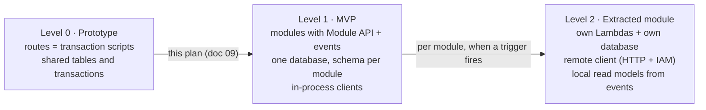
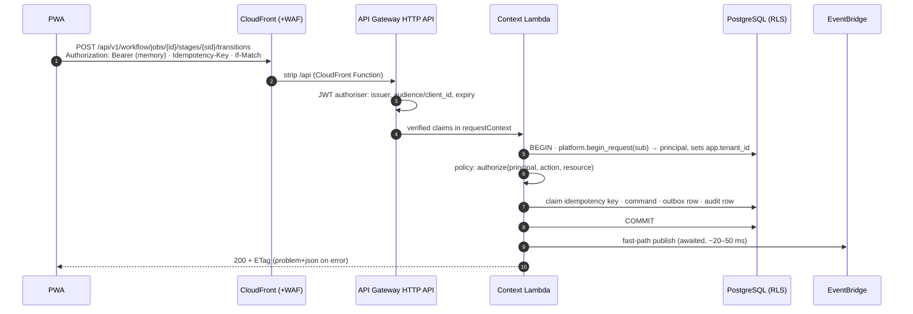
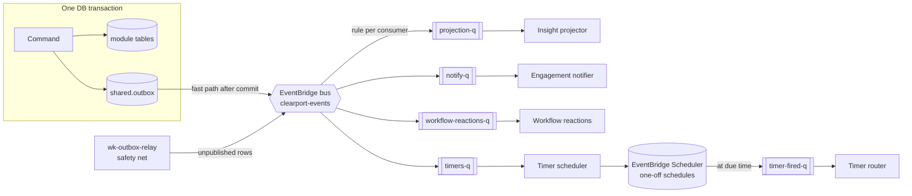
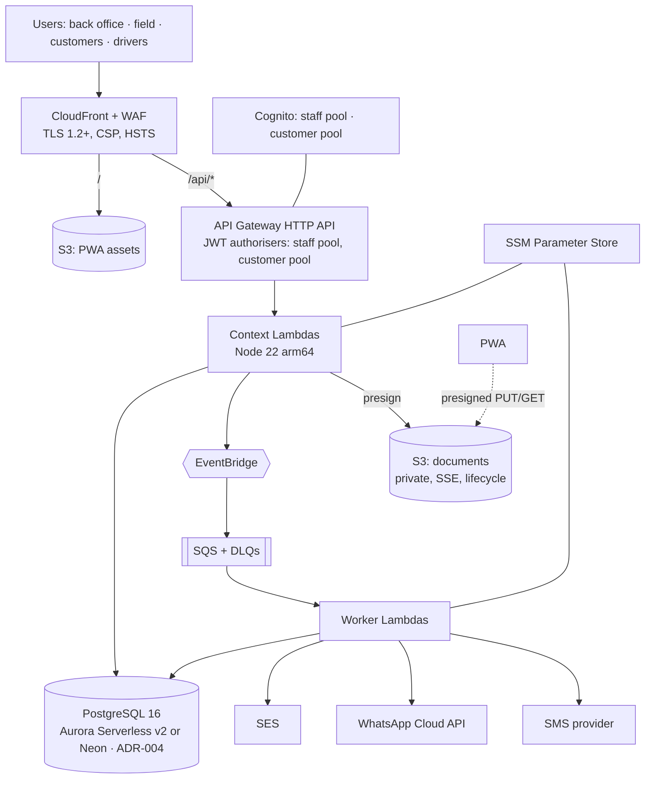

# 02 · Target architecture for the MVP

## 1. The pattern in one paragraph

ClearPort stays a **modular monolith on serverless**, as ADR-002 decided. What changes is that every module becomes **extraction-ready**: a hexagonal module (domain → application → adapters) that exposes exactly three things to the rest of the system: its **HTTP routes**, a typed **Module API** (commands and queries), and its **published events**. Other modules reach it only through a **client port** for that API. In the MVP the client is an in-process adapter. When a module needs to scale, deploy or be owned separately, we swap in a remote adapter and move its schema. No domain or application code changes. This is the "graceful extraction" guarantee, and [03-module-standard.md](03-module-standard.md) turns it into coding rules.

Industry names for the parts, so the team can look them up: *Modular Monolith* · *Hexagonal Architecture (Ports and Adapters)* · *CQRS (lightweight)* · *Transactional Outbox* · *Event-carried state transfer* · *Strangler Fig* for the refactor · *Token Handler / BFF* for browser auth.

## 2. Extraction levels

**The MVP target is Level 1 for every module.** Level 2 is not built in the MVP; the rules guarantee it stays a mechanical change. Move a module to Level 2 only when one of these triggers fires, and record it as an ADR:

- it needs a different scaling or availability profile (e.g. FieldOps GPS pings in P2);
- a separate team owns it;
- it needs a different data store or region (e.g. document AI if Textract is not in-region);
- its database load measurably harms the rest (Insight is the likely first, per SAD §11).

## 3. Runtime units

Modules are **code** boundaries. Runtime units are **deployment** boundaries. In Level 1, one runtime unit hosts one module's routes, and the Lambda bundle includes only the modules it needs.

### 3.1 Modules and consistency groups

A **consistency group** is a set of modules that may share one database transaction. Everything outside a group is eventually consistent. Groups are extracted together, never split.

| Consistency group | Modules | Why grouped | Likely Level 2 order |
|---|---|---|---|
| **Operations core** | Clearance, Workflow | A BL and its stage instances are created, closed and reopened atomically (JOB-001, DEL-004/005). Splitting them would make every intake a saga with no business benefit | Last |
| Platform | Platform (tenants, users, roles, master data, workflow config), Auth | Identity and configuration are read by everyone and change rarely | — (stays core) |
| Customer | Customer | Small, stable | Low |
| FieldOps | FieldOps (drivers, vehicles, trips, links, POD) | Most likely to need its own scaling (GPS, marketplace in P2/P3) | **1st candidate** |
| Finance | Finance (disbursements, floats, invoices) | Separate audience and audit rules; accounting connectors in P2 | 3rd |
| Engagement | Engagement (notifications, templates, approvals, portal) | Provider rate limits, retries, high fan-out | 2nd |
| Insight | Insight (projections, reports) | Read-heavy; first to get its own database replica | 2nd (database) |

### 3.2 Deployables

| Unit | Trigger | Contains | Notes |
|---|---|---|---|
| `web` | CloudFront + S3 | PWA (all shells) | Unchanged |
| `api-auth` | HTTP `/auth/*` | Token handler | Holds the Cognito client secret; only unit that sets cookies |
| `api-platform` | HTTP `/v1/platform/*` | Platform | |
| `api-customer` | HTTP `/v1/customers/*` | Customer | |
| `api-clearance` | HTTP `/v1/clearance/*` | Operations core (Clearance routes) | Clearance and Workflow keep separate Lambdas for warm-path isolation, as today |
| `api-workflow` | HTTP `/v1/workflow/*` | Operations core (Workflow routes) | |
| `api-fieldops` | HTTP `/v1/field/*`, `/public/trips/*` | FieldOps | `/public/*` has no JWT authoriser; WAF rate rule |
| `api-finance` | HTTP `/v1/finance/*` | Finance | |
| `api-engagement` | HTTP `/v1/notifications/*`, `/v1/portal/*`, `/public/approvals/*`, `/webhooks/*` | Engagement | `/v1/portal/*` uses the customer-pool authoriser |
| `api-insight` | HTTP `/v1/insight/*` | Insight | |
| `wk-<module>-<consumer>` | SQS (one queue per consumer) | One consumer each | Partial batch failures, DLQ, alarm |
| `wk-outbox-relay` | Scheduler (cron) | Relay | Business-hours cadence (06 §3) |
| `wk-timer-fired` | Scheduler (one-off) → SQS | Timer router | Replaces all scans (06 §5) |
| `wk-file-scan` | S3 `ObjectCreated` → SQS | Magic-byte check, later malware scan | Closes X-7 |
| `idp-triggers` | Cognito | Post-authentication audit, pre-sign-up guard | Doc 04 §3 |

Route prefixes are **the prototype's** (ADR-012). Paths do not change in the MVP.

## 4. Request path

Steps 5–7 run in **one transaction** and one connection (fixes S-3, S-4). Step 5 replaces token-embedded roles (fixes X-2, doc 04 §4).

## 5. Event path

Every queue has a DLQ (`maxReceiveCount: 5`) and a CloudWatch alarm on `ApproximateNumberOfMessagesVisible > 0`. Every consumer dedupes through `shared.inbox`.

## 6. Deployment topology

- **Region:** one Middle East region (`me-central-1` or `me-south-1`) **[Confirm residency]**.
- **Accounts:** `clearport-nonprod` (dev, preview, staging) and `clearport-prod` under AWS Organizations.
- **No VPC, no NAT** in the MVP. How Lambdas reach Aurora without a VPC is decided in [05 §5](05-data-architecture.md#5-connections-and-the-database-adapter).

## 7. Infrastructure as code

`infra/` (AWS CDK v2, TypeScript) is built in Sprint 0. One app, stacks per concern, one instance per environment:

| Stack | Resources |
|---|---|
| `IdentityStack` | Two Cognito user pools (staff, customer), app clients, managed login domain, triggers |
| `DataStack` | Database (per ADR-004), documents bucket + lifecycle, backup bucket (object lock) |
| `MessagingStack` | Event bus, SQS queues + DLQs, Scheduler group and role, SES identity |
| `ApiStack` | HTTP API, authorisers, routes, context Lambdas, per-function IAM roles, reserved concurrency |
| `WorkersStack` | Worker Lambdas and event-source mappings, EventBridge rules |
| `WebStack` | S3 site bucket, CloudFront, CloudFront Function, WAF web ACL (prod), security headers policy |
| `ObservabilityStack` | Dashboards, alarms, budgets, log retention |

Each Lambda gets its own role with only the actions it uses (e.g. `api-clearance` may `s3:PutObject` only under `tenant/*`; only `wk-timer-scheduler` may `scheduler:CreateSchedule`). The build already emits one bundle per context (`scripts/build-lambdas.mjs`); it is extended with worker entries.

## 8. How this maps to the Solution Architecture

| SAD item | MVP position |
|---|---|
| ADR-001 PWA | Unchanged |
| ADR-002 Modular monolith, one Lambda per context | Unchanged; strengthened by doc 03 and consistency groups |
| ADR-003 TypeScript, Hono, Drizzle, Zod | Unchanged |
| ADR-004 Postgres + RLS; Neon or Aurora | Unchanged; access path decided in ADR-015 |
| ADR-005 Cognito + token handler | Unchanged in shape; roles move from token to database (ADR-010) |
| ADR-006 Outbox + EventBridge + SQS | Unchanged; polling removed (ADR-011) |
| ADR-007 Document AI behind a port | P2, unchanged |
| ADR-008 Workflow as versioned configuration | Unchanged; hard-coded stage keys removed (doc 08 §4) |
| §8 paths `/v1/jobs…` | Superseded by ADR-012: prototype paths are v1 |
