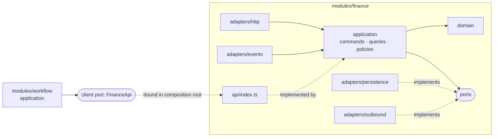

# 03 · Module standard: the coding pattern

This is the rulebook for backend code. A module that follows it can be lifted into its own serverless API by changing adapters and composition only (doc 02 §2). The rules are enforced by lint (§7) and by the Module API contract tests (doc 07 §2), not by review alone.

## 1. Vocabulary

| Term | Meaning |
|---|---|
| **Module** | A bounded context: Platform, Customer, Clearance, Workflow, FieldOps, Finance, Engagement, Insight |
| **Module API** | The typed commands and queries a module offers to *other modules*. Serializable DTOs only |
| **Client port** | An interface in the *calling* module's application layer, typed by the callee's Module API |
| **Published event** | A versioned, documented event other modules may subscribe to |
| **Consistency group** | Modules allowed to share a transaction (doc 02 §3.1). Only Clearance + Workflow in the MVP |
| **Principal** | Who is acting: a user, a link holder or a system process (doc 04 §6) |
| **Unit of work (UoW)** | One database transaction with tenant context, event collection, audit and idempotency |
| **Composition root** | The one file per runtime unit that creates adapters and wires them into modules |

## 2. Folder layout

```text
apps/api/src/
  shared/                    technical runtime only: http, db (UoW runner), bus, problem, idempotency, audit,
                             config, observability. Never imports a module. Owns only technical tables
                             (outbox, inbox, idempotency_key, audit_event)
  modules/<module>/
    domain/                  entities, value objects, invariants, domain errors. Pure TypeScript, no I/O
    application/
      commands/<verb-noun>.ts  one handler per command, e.g. record-disbursements.ts
      queries/<noun>.ts        one handler per query, e.g. job-finance-summary.ts
      ports.ts               repositories, Clock, IdGen, FileStore… and client ports to other modules
      policies.ts            authorisation rules for this module's actions (doc 04 §5)
    adapters/
      http/routes.ts         Hono: parse → principal → handler → HTTP mapping. No SQL, no rules
      persistence/schema.ts  Drizzle tables THIS module owns (moved out of shared/schema.ts)
      persistence/*.repo.ts  repository implementations
      events/consumers.ts    inbound event handlers (thin: map event → command)
      outbound/*.ts          provider adapters (SES, WhatsApp, S3 …)
    api/
      index.ts               Module API interface + Zod DTO schemas  ← the only import other modules may use
      events.ts              published event schemas (Zod, versioned)
      group.ts               (Clearance and Workflow only) in-transaction API for the consistency group
    module.ts                createXModule(deps) → { routes, api, consumers }
  units/                     composition roots, one per runtime unit (api-finance.ts, wk-insight-projector.ts, local.ts…)
packages/
  kernel/                    shared kernel: ids, Money, ContainerNo, Result, permission catalogue
  contracts/                 HTTP request/response schemas shared with the PWA
  workflow/                  the workflow engine (pure), used by the Workflow module and the PWA
```

`packages/contracts` describes the **public HTTP API** (browser ↔ server). `modules/<m>/api` describes the **Module API** (module ↔ module). They are different contracts with different consumers and change rules; do not merge them.

## 3. Layers and what goes where



### 3.1 Domain

Pure rules with no I/O, returning `Result` from `@clearport/kernel` for expected failures. The workflow engine (`packages/workflow/src/engine.ts`) is the model. Examples of rules that move here from route handlers: "a reconciled disbursement is immutable; corrections are reversals", "a trip's driver licence must be valid on the trip date", "a closed job rejects changes".

### 3.2 Application: commands and queries

One file per use case. A command handler:

1. loads what it needs through ports,
2. asks `policies.ts` whether the principal may do it (doc 04 §5),
3. runs domain rules,
4. persists through ports, emits events and writes audit **through the UoW**,
5. returns a `Result<Dto, ModuleError>` — it does not throw for expected failures, and it never builds HTTP responses.

```ts
// modules/finance/application/commands/record-disbursements.ts
import { err, ok, type Result } from '@clearport/kernel';
import type { RecordDisbursements, DisbursementDto } from '../../api';
import type { Clock, DisbursementRepo, DocumentsClient, IdGen, Principal, Uow, UsersClient } from '../ports';
import { authorize } from '../policies';
import type { FinanceError } from '../../domain/errors';

export const recordDisbursements =
  (deps: { repo: DisbursementRepo; documents: DocumentsClient; users: UsersClient; ids: IdGen; clock: Clock }) =>
  async (uow: Uow, principal: Principal, cmd: RecordDisbursements): Promise<Result<DisbursementDto[], FinanceError>> => {
    const denied = authorize(principal, 'disbursement.create', { jobId: cmd.jobId });
    if (denied) return err(denied);
    for (const d of cmd.items) {
      // Was: a direct select on clearance.document. Now: Clearance's Module API.
      if (d.receiptDocumentId && (await deps.documents.jobOf(principal, d.receiptDocumentId)) !== cmd.jobId) {
        return err({ code: 'RECEIPT_NOT_ON_JOB', message: 'Receipt must be a document on this job' });
      }
    }
    const rows = await deps.repo.insert(uow, /* … build rows … */ []);
    rows.forEach((r) => uow.emit('finance.DisbursementRecorded', 1, r.jobId, { jobId: r.jobId, disbursementId: r.id /* … */ }));
    await uow.audit({ action: 'disbursement.recorded', entityType: 'job', entityId: cmd.jobId, after: rows.map((r) => r.id) });
    return ok(rows);
  };
```

Queries follow the same shape without `uow.emit`/`audit`, and may read from the module's own tables or from Insight projections it owns.

### 3.3 HTTP adapter

Routes stay as thin as possible and keep **today's paths and response bodies** (ADR-012):

```ts
// modules/finance/adapters/http/routes.ts
r.post('/disbursements', async (c) => {
  const cmd = await parseBody(c, RecordDisbursementsInput);          // contracts package, unchanged
  const res = await c.var.uow.run((uow) => handlers.recordDisbursements(uow, c.var.principal, cmd));
  return sendResult(c, res, 201);                                     // Result → 2xx body or RFC 9457 problem
});
```

`sendResult` maps `ModuleError.code` to a status through one table per module (`NOT_FOUND`→404, `CONFLICT`/`GATE_NOT_MET`→409, `VALIDATION`→422, `PRECONDITION`→412, `FORBIDDEN`→403 or 404 for out-of-scope ids). The problem body keeps today's shape (`type`, `title`, `status`, `detail`, `errors[]`, `requestId`), so the PWA does not change.

### 3.4 Unit of work

`shared/db.ts` `withTenant` grows into a `UowRunner` port with one Postgres adapter. One `run()` is **one transaction** that:

1. resolves the principal and sets `app.tenant_id` / `app.customer_id` (doc 04 §4) — one round trip;
2. claims the `Idempotency-Key` scoped to `(tenant, principal, key)` (fixes S-4 and X-6);
3. runs the handler;
4. writes collected events to `shared.outbox`, audit rows to `shared.audit_event`, and the response to `shared.idempotency_key`;
5. commits, then fast-path publishes.

If the handler returns an error or throws, the transaction rolls back and the idempotency claim disappears with it, so the client can retry cleanly. A concurrent duplicate blocks on the key's unique index until the first commits, then replays its stored response.

## 4. Talking to other modules

| I need to… | Use | Never |
|---|---|---|
| show or check another module's data | a **query** on its Module API through a client port | `select` from its tables; import its `schema.ts` |
| react when something happened elsewhere | **subscribe** to its published event | poll its tables |
| make another module change something as part of my command | a **command** on its Module API through the **command relay** (§5) | write its tables; pass my transaction |
| change state atomically in two modules | only inside a consistency group, via `api/group.ts` | anything else; redesign instead |
| build a cross-module list or report | an **Insight** projection fed by events (doc 05 §6) | join across schemas in a write path |

### 4.1 Module API shape

```ts
// modules/finance/api/index.ts — the ONLY file other modules import from finance
import { z } from 'zod';
export const JobFinanceSummary = z.object({ currency: z.string(), paid: z.string(), billable: z.string(), unreconciled: z.number().int() });
export type JobFinanceSummary = z.infer<typeof JobFinanceSummary>;
export const RecordDisbursements = z.object({ jobId: z.uuid(), stageInstanceId: z.uuid().nullable(), stageKey: z.string().nullable(), items: z.array(/* … */) });
export type RecordDisbursements = z.infer<typeof RecordDisbursements>;

export interface FinanceApi {
  recordDisbursements(call: Call, cmd: RecordDisbursements): Promise<ApiResult<{ ids: string[] }>>;
  jobFinanceSummary(call: Call, q: { jobId: string }): Promise<ApiResult<JobFinanceSummary[]>>;
}
```

Rules for every Module API:

- **Serializable.** DTOs are Zod schemas of JSON-safe values (ISO strings for dates, string amounts for money). No Drizzle row types, no class instances, no functions. This is what lets the remote adapter exist.
- **`Call` carries context, never a transaction:** `{ principal, requestId, idempotencyKey? }`. The callee authorises using the principal; the caller does not authorise on its behalf.
- **Results, not exceptions:** `ApiResult<T> = Result<T, { code: string; message: string; details?: unknown }>`.
- **Coarse-grained.** One call per screen need (e.g. `jobFinanceSummary`), not one per row. A remote call costs 20–60 ms.
- **Additive change only.** Breaking changes mean a new method name (`…V2`), with the old one kept until every caller moves.

### 4.2 Client ports and adapters

The caller declares what it needs in its own `ports.ts` using the callee's types:

```ts
// modules/workflow/application/ports.ts
import type { FinanceApi } from '../../finance/api';
export type FinanceClient = Pick<FinanceApi, 'recordDisbursements'>;   // depend on only what you use
```

The composition root binds it. Level 1 uses the in-process adapter, which simply calls the other module's `api` object (its own UoW). Level 2 uses a remote adapter generated from the same interface (§8).

### 4.3 The consistency-group API

`clearance/api/group.ts` and `workflow/api/group.ts` expose functions that accept the caller's `Uow`, e.g. `createJobStages(uow, jobId, wf)` and `closureBlockers(uow, jobId)`. Lint allows importing `api/group.ts` only from the other module in the same group (§7). This keeps today's atomic intake, closure and reopen without opening a back door for everyone else.

## 5. Command relay: cross-group writes without a shared transaction

Today `transitionStage` records disbursements and requests customer approval inside its own transaction (A-4), and FieldOps updates workflow stages inside its own (A-10). The user sees the result immediately. The command relay keeps that behaviour while never sharing a transaction.

```mermaid
sequenceDiagram
  autonumber
  participant WF as Workflow (caller)
  participant DB as Workflow UoW
  participant FI as Finance API (callee)
  participant Q as relay consumer (Finance)
  WF->>DB: transition stage + outbox event StageTransitioned{disbursements[], relayId}
  DB-->>WF: COMMIT
  WF->>FI: recordDisbursements(call{idempotencyKey: relayId}, cmd)
  alt call succeeds
    FI-->>WF: ok → response includes the ledger, as today
  else call fails or Lambda dies
    Note over WF: response still 200: the stage moved; ledger shows "recording…"
    Q->>FI: on StageTransitioned: recordDisbursements(same relayId)
    FI-->>Q: ok, or replayed if the sync call had committed
  end
```

Rules:

1. The caller commits **its own change plus an event that fully describes the follow-up command**. The event is the guarantee.
2. After commit, the caller makes the call **synchronously** with `idempotencyKey = relayId` (the event id + index), so the happy path looks exactly like today.
3. The callee module subscribes to the same event and runs the same command with the same key. Whichever comes second is a no-op.
4. The callee's command must be idempotent on that key and valid on its own (it re-checks rules and authorisation with the principal from the event).
5. Use the relay only where the user must see the effect in the same response. Otherwise just subscribe to the event.

Relays needed in the MVP:

| Caller → callee | Command | Today |
|---|---|---|
| Workflow → Finance | `recordDisbursements` for payments sent with a transition | shared `tx` |
| FieldOps → Workflow | `assignContainerStages` + `transition TRUCK→ASSIGNED` on trip create; reverse on cancel | FieldOps writes `stage_instance` directly |
| FieldOps (driver link) → Workflow | `transitionStage` as a `driver-link` principal | shared `tx`, `skipPermission` |
| Workflow → Engagement | `requestCustomerApproval` | shared `tx`; **becomes event-only** (the approval is sent asynchronously anyway) |
| Engagement → Workflow | `CustomerApprovalDecided` → transition | already event-driven ✅ |

## 6. Composition roots

Adapters are chosen in exactly one place per runtime unit, never by `config.X === …` at module level (A-5):

```ts
// units/api-finance.ts
const infra = createInfra(config);                     // pg/Data API pool, S3, EventBridge, clock, ids, logger
const platform = createPlatformModule(infra);          // in-process: Finance needs users
const clearance = createClearanceModule(infra, { /* only what Finance needs, see below */ });
const finance = createFinanceModule(infra, {
  documents: clearance.api,                            // Level 1: in-process client
  users: platform.api,
});
export const handler = lambdaHttp(createApp((app) => app.route('/v1/finance', finance.routes)));
```

`units/local.ts` mounts every module's routes and runs every consumer in-process, as `local.ts` does today. Tests build modules with fakes. Feature flags and per-tenant settings are read through a `TenantSettings` port from Platform, not from `config`.

## 7. Enforcement (dependency-cruiser)

Add `.dependency-cruiser.cjs` (the `lint:boundaries` script already expects it, A-8) with these rules, all `error` severity, run in CI:

| # | Rule |
|---|---|
| B-1 | `modules/X/**` may import from `modules/Y/**` only via `modules/Y/api/index.ts` or `modules/Y/api/events.ts` |
| B-2 | `modules/Y/api/group.ts` may be imported only by modules in Y's consistency group |
| B-3 | `modules/*/domain/**` imports only `@clearport/kernel`, `@clearport/workflow` and its own `domain/` |
| B-4 | `modules/*/application/**` must not import `drizzle-orm`, `pg`, `hono`, `@aws-sdk/*`, or any `adapters/` |
| B-5 | `modules/X/adapters/persistence/schema.ts` is importable only inside `modules/X/adapters/persistence/**` and by migrations tooling |
| B-6 | `shared/**` must not import `modules/**` |
| B-7 | `units/**` is not importable by anything |
| B-8 | `packages/contracts` must not import server-only packages |

## 8. Level 2 extraction recipe (for later; proves the rules are enough)

1. **Internal routes:** add `adapters/http/internal-routes.ts` that exposes each `XApi` method as `POST /internal/x/{method}`, generated from the `api/index.ts` schemas. Protect with an API Gateway **IAM authoriser**.
2. **Remote client:** add `x/api/remote-client.ts` implementing `XApi` with SigV4-signed `fetch`. Principal propagation: for user-initiated calls, forward the caller's access token and `x-request-id` (the callee resolves the principal itself); for system calls, the caller's IAM role maps to a named system principal (doc 04 §7).
3. **Swap bindings** in the other units' composition roots. Run the Module API contract suite against the remote client; it must pass unchanged.
4. **Replace chatty reads** with local read models fed by X's events where latency matters.
5. **Move data:** new database for X (its schema, RLS policies, its own outbox and inbox), copy with logical replication, cut over in a maintenance window.
6. **Remove X** from other bundles.

Steps 1–4 touch no domain or application code. If they would, a rule above was broken; fix the rule violation first.

## 9. Definition of done: a module at Level 1

- [ ] Routes contain no SQL and no business rules; each calls one command or query.
- [ ] The module's tables live in its own `adapters/persistence/schema.ts`; no other module imports them.
- [ ] `api/index.ts` exists with Zod DTOs; facade functions taking `tx` are gone (except `api/group.ts` within the group).
- [ ] Published events are declared in `api/events.ts` with a version.
- [ ] Authorisation lives in `application/policies.ts` and is unit-tested per role (doc 04 §5).
- [ ] Characterisation tests for its endpoints pass unchanged (doc 07 §2).
- [ ] Module API contract tests exist and run against the in-process adapter.
- [ ] dependency-cruiser passes with no exceptions for the module.
