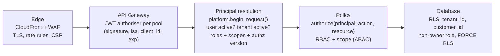

# 04 · Identity and access

**Principle: Cognito authenticates; ClearPort authorises.** Cognito proves *who* is calling. ClearPort's database decides *which tenant they act in and what they may do*, on every request, inside the same transaction that enforces RLS. This keeps the prototype's approach (token-handler cookie, in-memory access token, RBAC map, RLS) and closes the gaps in [01 §3.3](01-current-state-assessment.md#33-security).

## 1. Who calls the system

| Principal kind | Who | How they authenticate | Channel | BRD |
|---|---|---|---|---|
| `user` | Owner, admin, coordinator, PRO, inspector, in-house driver, accounts | Staff user pool: password + TOTP (mandatory for privileged roles) | PWA back-office and field shells | ADM-001, NFR-002 |
| `customer` | Importer contacts | Customer user pool: email one-time code | PWA portal shell | CXP-001, CUS-002 |
| `driver-link` | Third-party drivers | 256-bit link token, hashed at rest | `/trip/{token}` page | TRK-004 |
| `approval-link` | Customer contact approving charges | 256-bit link token, hashed at rest | `/approve/{token}` page | BAY-005 |
| `system` | Workers, timers, relays | AWS IAM (the Lambda's role) | Internal | — |
| `webhook` | WhatsApp, later payment gateway | Provider signature (HMAC) | `/webhooks/*` | NTF-002 |
| `platform-admin` | SaaS operator (P2) | Separate pool, separate console | Admin console | ADM-005 |
| `api-client` | Customer API (P3) | OAuth client credentials | `/v1/*` | P3 |

## 2. Layers of defence



A failure at any single layer does not expose data: RLS still returns zero rows for another tenant even if a policy check is missing (QA-1).

## 3. Authentication

### 3.1 Two Cognito user pools

| | Staff pool | Customer pool |
|---|---|---|
| Sign-in | Email + password; TOTP MFA | Email one-time code (passwordless) **[Confirm feature plan, see §3.6]** |
| MFA policy | Pool setting *optional*; enforced per role by the token handler (§3.3) | None (the one-time code is the factor) |
| Self sign-up | Disabled (admins invite) | Disabled in MVP (agency invites contacts); CXP-002 self-service is P2 |
| App client | `clearport-web-staff` (confidential, used only by `api-auth`) | `clearport-web-customer` (confidential, used only by `api-auth`) |
| API Gateway authoriser | All `/v1/*` except `/v1/portal/*` | `/v1/portal/*` only |

Two pools rather than one pool with groups, because the sign-in method, MFA policy and password policy differ, a breach or misconfiguration in one cannot affect the other, and the gateway can refuse a customer token on staff routes **before** any Lambda runs.

### 3.2 Token handler (backend-for-frontend), extended from the prototype

`api-auth` is the only component that talks to Cognito's OAuth endpoints and the only one that sets cookies. The PWA never sees a refresh token, and never stores any token.

| Endpoint | Behaviour |
|---|---|
| `GET /auth/login?audience=staff\|customer&return=/…` | Creates PKCE verifier + `state`, stores them in a 5-minute encrypted `HttpOnly` cookie, redirects to Cognito managed login |
| `GET /auth/callback` | Checks `state`, exchanges the code with the client secret (from SSM), runs the MFA rule (§3.3), sets `cp_refresh`, redirects to `return` (allow-listed same-origin paths only) |
| `POST /auth/refresh` | Requires header `x-cp-csrf: 1`. Exchanges `cp_refresh` for a new access token; returns `{ accessToken, expiresIn, user }` — **same body as today** |
| `POST /auth/logout` | Revokes the refresh token at Cognito, clears the cookie |
| `GET /auth/config` | Unchanged |
| `POST /auth/dev-login`, `GET /auth/demo-users` | **Dev builds only.** Removed from non-dev bundles at build time with an esbuild `define` (`__DEV_AUTH__ = false`) so the code does not exist in production (fixes X-1) |

Cookie: `cp_refresh`, `HttpOnly; Secure; SameSite=Strict; Path=/api/auth`, as today. `SameSite=Strict` plus the custom header blocks cross-site refresh attempts.

The PWA change is small: the login page redirects to `/api/auth/login` instead of posting an email; `refreshSession()` adds the CSRF header. Everything else in [api.ts](../../apps/web/src/lib/api.ts) stays.

### 3.3 MFA for privileged roles (NFR-002)

BRD: mandatory for owner and accounts; we add admin. Other roles may opt in.

- Each role has `requiresMfa` (system roles: OWNER, ADMIN, ACCOUNTS = true).
- On every code exchange and every refresh, `api-auth` checks server-side (Cognito `AdminGetUser`, IAM-authorised) whether the user has TOTP enabled. If any of their roles requires MFA and TOTP is not enabled, no session is issued; the user is sent to the enrolment page.
- Once TOTP is enabled, Cognito challenges for it at every sign-in.
- Browser-held access tokens are issued **without** the `aws.cognito.signin.user.admin` scope, so a user cannot call Cognito directly to switch MFA off or change attributes.
- Admin "reset MFA" is a Platform command (`AdminSetUserMFAPreference`), audited.

**Spike AUTH-2 (Sprint 1):** confirm the enrolment call path that works without exposing the admin scope to the browser (token-handler-held session vs. a dedicated enrolment client).

### 3.4 Token lifetimes and revocation

| Token | Lifetime | Notes |
|---|---|---|
| Access | 15 min | In PWA memory only. Bounds how long a stolen token works |
| Refresh (staff) | 7 days **[Confirm]** | Long enough for field users offline over a weekend; rotation on use if available on the chosen feature plan **[Verify]** |
| Refresh (customer) | 30 days **[Confirm]** | |
| Link tokens | 48 h, single trip/approval, revoked on completion | Unchanged |

Revocation does not wait for tokens to expire. Deactivating a user, removing a role or "sign out everywhere":

1. updates `platform.app_user` (`active`, roles) and increments `authz_version`;
2. calls `AdminUserGlobalSignOut` (refresh tokens stop working);
3. takes effect on the **next request**, because principal resolution reads the database every time (§4).

### 3.5 Login audit (ADM-004)

A Cognito **post-authentication** trigger puts a `platform.UserSignedIn` event on the bus (no database connection from the trigger). An audit consumer writes it to `shared.audit_event`. Permission and role changes are audited by the Platform commands that make them.

### 3.6 Cognito feature plan

Customer passwordless sign-in uses Cognito's choice-based sign-in with email one-time codes, which requires the **Essentials** feature plan. Because ClearPort does not put roles in tokens (§4), we do **not** need access-token customisation. **[Verify]** current Cognito feature-plan pricing and free MAU tier, and that Cognito with these features is offered in the chosen Middle East region, before Sprint 1. Fallback if unavailable: customer pool with email + password and a "magic link" issued by `api-auth`.

## 4. Principal resolution

On every request, the first statement of the unit of work (doc 03 §3.4) is:

```sql
select * from platform.begin_request($issuer, $sub, $request_id);
```

`begin_request` is a `SECURITY DEFINER` function (same pattern as today's `find_login`):

1. finds the `platform.identity` row for `(issuer, sub)` → `user_id`;
2. checks the user and the tenant are active;
3. loads the user's role grants with scopes and `authz_version`;
4. sets `app.tenant_id`, `app.customer_id`, `app.user_id` with `set_config(…, true)` — transaction-local, exactly as `withTenant` does now;
5. returns the principal: `{ userId, tenantId, customerId, roles[], grants[], authzVersion, locale }`.

No match, inactive user or inactive tenant → 401 with the existing problem body. Cost: zero extra round trips; it replaces the `set_config` statement we already run.

Why the database and not token claims:

| Concern | Roles in token (prototype Cognito path) | Roles resolved in DB (MVP) |
|---|---|---|
| Tenant-specific roles and branch scope | Pool-wide groups cannot express them | Natural |
| Revoking a role | Waits up to 15 min | Next request |
| Custom roles per tenant (ADM-001) | Needs a token customisation trigger | Data change only |
| Cognito feature-plan dependency | Access-token customisation tier | None |
| Extraction (Level 2) | Each service trusts claims | Each service resolves from Platform's API or a replicated read model |

**MVP constraint:** one identity belongs to one tenant. A customer contact who works with two agencies gets two identities (two emails or two invitations). Multi-tenant membership with a tenant switcher is P2 **[Confirm]**.

## 5. Authorisation model

### 5.1 Permissions (code) and roles (data)

- **Permission catalogue** stays in `@clearport/kernel` as stable strings, as today (`job.read`, `disbursement.reconcile`…). Stage permissions `stage.<KEY>.update` are generated from the workflow catalogue, so a stage added in settings (ADM-002) gets its permission automatically.
- **Roles become data** (ADM-001):
  - `platform.role(id, tenant_id, key, name, system, requires_mfa, permissions text[])`. The 8 current roles are seeded per tenant as **system roles** with exactly today's grants from `ROLE_PERMISSIONS`, and cannot be edited.
  - Tenants may add **custom roles** with any subset of the catalogue.
  - `platform.user_role(user_id, role_id, scope jsonb)` replaces `app_user.roles text[]` (expand/contract migration, doc 05 §4).
- The PRO role's hard-coded stage list (`stage.BAYAN.update`, …) is replaced by the catalogue's `ownerRole` / `permissionRoles` on each stage, so new stages need no code change (fixes part of A-7).

### 5.2 Scopes (ABAC)

A grant may carry a scope. A grant without one applies tenant-wide (today's behaviour).

| Scope attribute | Applies to | Source on the resource |
|---|---|---|
| `branchIds` | Jobs and everything under them | `clearance.job.branch_id` (new; every existing job maps to the tenant's default branch) |
| `ports` | Jobs | `job.port_of_discharge` |
| `assignment` = `self` | Stage updates by field roles | `stage_instance.assignee_id` is the user or null (today's `isSupervisor` rule, made explicit) |
| `customerId` | Customer principals | `job.customer_id` — also enforced by RLS, as today |

### 5.3 Evaluation

```ts
// modules/<m>/application/policies.ts uses one shared evaluator
authorize(principal, 'stage.BAYAN.update', { branchId, port, assigneeId })
  → null                        // allowed
  | { code: 'NOT_FOUND' }       // resource exists but is outside every scope the principal has → 404 (no probing)
  | { code: 'FORBIDDEN' }       // in scope, but no grant has the permission → 403
```

Deny by default. A request is allowed if **any** grant matches the permission pattern **and** its scope matches the resource. For lists, the same grants become SQL filters (`scopeFilter(principal, 'job.read')` → `branch_id = any($1)`) so out-of-scope rows never load.

RLS continues to enforce tenant and customer isolation. Branch scope is enforced in the application only in the MVP; adding it to RLS is an option for the Enterprise tier.

### 5.4 The PWA

`GET /v1/platform/me` returns the **effective permissions** (computed server-side) and scopes. `useAuth().can()` reads that list instead of importing `ROLE_PERMISSIONS` from the kernel. For the 8 system roles the result is identical to today; a test asserts this for every role and permission. Custom roles then work in the UI without a release.

### 5.5 Tests

A table-driven policy matrix (role × action × resource scope → expected decision) is generated from the catalogue and must cover 100% of permissions, the same bar the SAD sets for gate specifications.

## 6. Non-user principals (replacing `skipPermission`)

`skipPermission: true` is removed (X-5). Each non-user principal has a **fixed, narrow grant set bound to one resource**, and goes through the same `authorize()`:

| Principal | Resolved by | Grants |
|---|---|---|
| `driver-link` | `fieldops.resolve_trip_token(hash)` | `stage.{TRUCK,RELEASE,DELIVERY}.update` with scope `containerIds = trip's containers`; `document.upload` for `POD` on those containers |
| `approval-link` | `engagement.resolve_approval_token(hash)` | `approval.decide` on that approval only |
| `webhook:whatsapp` | `X-Hub-Signature-256` HMAC with the app secret, constant-time compare | `notification.status.update` |

Link hardening:

- WAF rate-based rule on `/api/public/*` per IP **[tune in pilot]**; constant-time hash lookup (unchanged).
- Tokens are in the URL path, so **access logs must not contain them**: API Gateway and CloudFront logs record the route template (`/public/trips/{token}`), not the raw path; `Referrer-Policy: no-referrer` on link pages.

## 7. System principals (fixes X-4)

`systemActor()` with role `OWNER` is replaced by **named system principals**, each with only what its job needs:

| Principal | Used by | Grants |
|---|---|---|
| `system:workflow-reactions` | Approval decided, trip assigned/cancelled relays | `stage.*.update`, `stage.assign` |
| `system:finance-relay` | Disbursement relay | `disbursement.create` |
| `system:notifier` | Engagement consumers | `notification.create`, read of contacts |
| `system:projector` | Insight | read only |
| `system:timers` | Timer router | `sla.breach.raise`, `freetime.alert.raise` |

Audit rows show the system principal's name, and for relays the original user (`on behalf of`), so the trail still answers "who did this".

At Level 2, a system call between services is authenticated by the calling Lambda's **IAM role** (API Gateway IAM authoriser on `/internal/*`), which maps to one of these names. User-initiated calls forward the user's access token (token relay) and the callee resolves the principal itself.

## 8. Edge and transport

- One origin for the PWA and the API through CloudFront (`/api/*`), as in local dev, so cookies are first-party and CORS stays closed.
- CSP without inline scripts, `frame-ancestors 'none'`, HSTS, `Permissions-Policy` with camera and geolocation only on field routes.
- API Gateway per-route throttling. **Correction to SAD §8:** HTTP APIs have no usage plans, so per-tenant *limits* are not available at the gateway. MVP meters per-tenant usage (doc 07 §5); per-tenant limiting, if needed, is done in the application.
- WAF (managed core rule set + IP reputation + rate rules) in production.

## 9. Local development and tests

- `AUTH_MODE=dev` stays for local and the Playwright suite, with the seeded demo users. It now also goes through `platform.begin_request()`, using `issuer = clearport-dev`, so local runs exercise the real authorisation path.
- Staging uses real Cognito with test users; a post-deploy smoke test signs in through the real flow.
- `config.ts` already refuses `AUTH_MODE=dev` with `NODE_ENV=production`; the build-time removal (§3.2) adds a second barrier.

## 10. Migration from the prototype

1. Add `platform.identity`, `platform.role`, `platform.user_role`, `platform.branch`; seed system roles and a default branch per tenant; backfill `user_role` from `app_user.roles` (expand).
2. Add `platform.begin_request()`; switch `withTenant` to call it (dev issuer first). Characterisation suite must stay green.
3. Move policy checks to `authorize()` with grants from the principal. Policy matrix test asserts parity with `ROLE_PERMISSIONS` for system roles.
4. Add `/v1/platform/me` permissions; switch the PWA's `can()` to it.
5. Stand up Cognito pools (CDK), the token handler endpoints, MFA enforcement and the login audit trigger. Import staff users (invitation email), link identities.
6. Replace `skipPermission` and `systemActor` with link and system principals.
7. Stop reading `app_user.roles` (contract); drop the column one release later.
