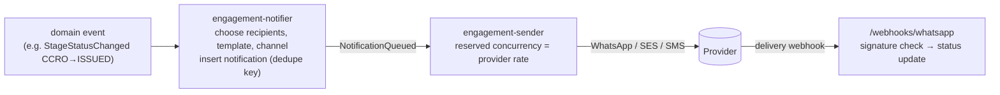
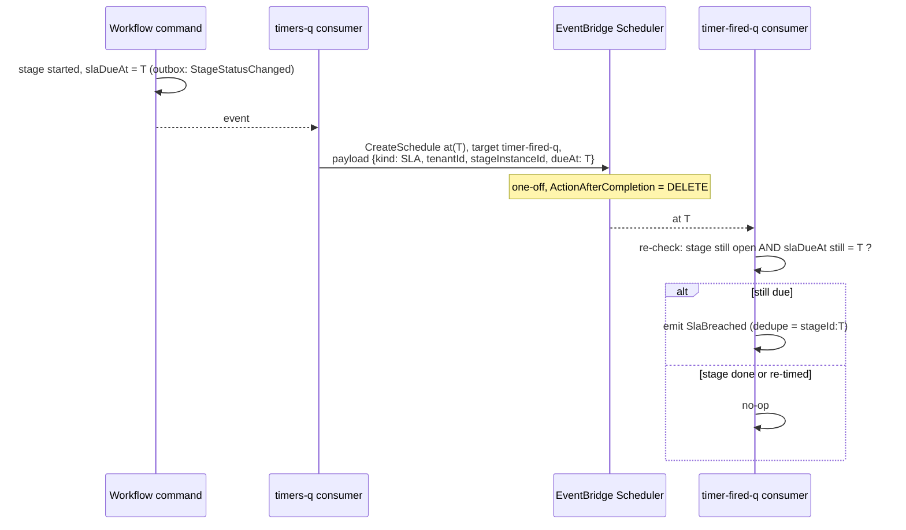

# 06 · Events, async work and timers

Rule: **nothing polls.** Side effects are events; timers are one-off schedules. In the prototype, four interval jobs ([local.ts](../../apps/api/src/local.ts)) query every tenant every 30–60 seconds; in production that keeps the database awake around the clock (S-1). This document replaces each of them.

| Prototype poller | Interval | MVP replacement | § |
|---|---|---|---|
| `relayOutbox` | 30 s | Fast path + failure signal + business-hours safety run | 3 |
| `dispatchAllTenants` (notifications) | 30 s | `NotificationQueued` event → sender queue | 4 |
| `scanSlaBreaches` | 60 s | One-off Scheduler timer per stage SLA | 5 |
| `scanFreeTime` | 1 h | One-off Scheduler timers at T-3, T-1, T-0 per container | 5 |

## 1. Event envelope (v1)

Backward compatible with today's `DomainEvent` ([events.ts](../../apps/api/src/shared/events.ts)): existing fields keep their names, new ones are added.

```ts
interface DomainEvent<P> {
  id: string;               // UUIDv7, also the inbox dedupe key
  type: string;             // unchanged names, e.g. 'StageStatusChanged'
  version: number;          // NEW. Payload schema version, starts at 1
  module: string;           // NEW. Owning module, e.g. 'workflow'; EventBridge Source = `clearport.${module}`
  tenantId: string;
  aggregateType: string;
  aggregateId: string;
  occurredAt: string;       // ISO 8601 UTC
  correlationId: string;    // NEW. The originating request id (x-request-id), carried through every hop
  causationId?: string;     // NEW. The event that caused this one, for relays and reactions
  actor: { kind: string; id: string | null; name: string };   // NEW. Principal that caused it (doc 04 §1)
  payload: P;               // validated by the Zod schema in the owner's api/events.ts
}
```

Change rules:

- Adding an optional payload field: same `version`.
- Removing or changing the meaning of a field: new `version`; the producer publishes **both** versions until every consumer has moved, then drops the old one.
- Payloads carry the state consumers need (event-carried state transfer), so consumers do not read the producer's tables (doc 05 §6).
- No personal data beyond names already shown in the UI; never tokens, signatures or receipt images (the prototype already masks `podSignature`, keep that).

## 2. Event catalogue

Owners publish; the table is the contract. Add a row before publishing a new event.

| Event | Owner | Main consumers | Status |
|---|---|---|---|
| `JobCreated`, `JobUpdated`, `ContainerAdded`, `JobClosed`, `JobReopened` | Clearance | Insight, Engagement, timers (free time) | Exists |
| `DocumentUploaded`, `CommentAdded` | Clearance | Insight, Engagement (mentions) | Exists |
| `StageStatusChanged`, `StageAssigned`, `ContainerStagesSpawned` | Workflow | Insight, Engagement, timers, FieldOps (trip progress), Finance (relay) | Exists; payload gains `disbursements[]`, `relayId` |
| `ContainerHeld` | Workflow | Engagement, Insight | **New** (PHY-003) |
| `SlaBreached`, `FreeTimeExpiring`, `DoValidityExpiring` | Workflow (timer router) | Engagement, Insight | First two exist; DO is **new** (DO-004) |
| `DisbursementRecorded`, `DisbursementReconciled`, `InvoiceIssued` | Finance | Insight, Engagement | Exists |
| `CustomerApprovalRequested`, `CustomerApprovalDecided` | Engagement | Workflow | Exists |
| `NotificationQueued` | Engagement | Engagement sender | **New** |
| `TripAssigned`, `TripCancelled`, `PodCaptured` | FieldOps | Workflow (relay), Engagement, document worker | `TripAssigned` exists; others **new** |
| `UserSignedIn`, `RoleChanged`, `UserDeactivated` | Platform | Audit consumer | **New** |

## 3. Publishing: outbox, fast path and the safety net

Unchanged core: the command writes its events to `shared.outbox` in the same transaction; after commit, the API Lambda publishes them to EventBridge (awaited, so a frozen Lambda cannot strand them).

What changes is the **safety net**, so that it does not wake the database:

1. **Fast path** succeeds → rows marked published. The normal case.
2. **Fast path fails** (EventBridge throttled, timeout) → the Lambda sends one message to the `outbox-relay-q` SQS queue with a 30-second delay. No database involved. The relay Lambda runs on that message.
3. **Lambda dies between commit and publish** (rare: no signal possible) → the **scheduled relay** catches it: every minute from 06:00 to 22:00 in the tenants' region time, hourly otherwise. **[Confirm hours]**
4. The relay reads `shared.pending_outbox()` (definer function, unchanged) for rows older than 30 seconds and republishes. Consumers dedupe through `shared.inbox`, so double publishing is harmless.

## 4. Consumers and queues

- **One SQS queue per consumer**, fed by an EventBridge rule on `detail-type` (and `source` where needed). Example: `insight-projector-q`, `engagement-notifier-q`, `engagement-sender-q`, `workflow-reactions-q`, `finance-relay-q`, `fieldops-trip-progress-q`, `timers-q`, `timer-fired-q`, `audit-q`.
- **Handler shape:** batch size 10, `ReportBatchItemFailures` (the prototype's `sqsConsumer` already does this), visibility timeout = 6 × function timeout, `maxReceiveCount: 5`, then the DLQ.
- **Idempotent:** `shared.inbox (consumer, event_id)` in the same transaction as the work, as today.
- **Order-tolerant:** standard queues do not guarantee order. Consumers re-read current state (the projector rebuilds the row; reactions check the stage is still in the expected status) instead of trusting event order. Use FIFO queues (`MessageGroupId = jobId`) only if a consumer cannot be made order-tolerant, and record why.
- **Consumers are thin:** map the event to a command of their own module and call it (doc 03 §3.2). Business rules never live in a consumer.
- **DLQ runbook:** an alarm fires on the first message; the on-call engineer inspects, fixes, and redrives with the SQS redrive API. Messages are never deleted from a DLQ without a ticket.

### Notification pipeline (replaces the dispatcher poll)



- The **sender's reserved concurrency** throttles to the provider's rate limit; retries use SQS redelivery with backoff (visibility timeout), never sleeps inside the Lambda.
- WhatsApp messages outside the 24-hour service window must use **approved templates**. The prototype sends free-form text ([channels.ts](../../apps/api/src/shared/channels.ts)), which works only for replies. MVP: platform-managed template set in English and Arabic (NTF-002); tenant-editable templates are P2 (NTF-003).
- No WhatsApp message to a contact without `whatsapp_opt_in_at` (doc 05 §9).

## 5. Timers with EventBridge Scheduler



- **Stale-tolerant timers.** We do not cancel schedules when a stage completes; the timer re-checks state when it fires and does nothing if it no longer applies. This removes all cancel logic and race conditions. A schedule costs a fraction of a cent and deletes itself after firing.
- **Deterministic names** (`hash(tenantId, kind, entityId, dueAt)`, under the 64-character limit) make creation idempotent: a redelivered event tries to create the same name and gets a conflict, which the consumer treats as success.
- **Registry:** `workflow.timer (tenant_id, kind, entity_id, due_at, schedule_name, fired_at)` records what was scheduled, so timers can be rebuilt if the schedule group is ever recreated, and so the UI can show "alert due on…".
- **Business-day alerts** (free time, DO validity, licence expiry) fire at 08:00 in the tenant's time zone (`platform.tenant.timezone`), not at midnight UTC.

| Timer | Created when | Fires | Emits (if still valid) | BRD |
|---|---|---|---|---|
| Stage SLA | Stage becomes actionable or is re-timed | `slaDueAt` | `SlaBreached` | OPS-004 |
| SLA warning | Same | at `warnAtPercent` of the SLA (catalogue) | `SlaWarning` → amber on board | OPS-004 |
| Free time | Container's `free_time_expires_at` set or changed | T-3, T-1, T-0 at 08:00 | `FreeTimeExpiring` (only if not gated out) | §9 basic |
| DO validity | DO stage `validUntil` recorded | T-3, T-1, T-0 at 08:00 | `DoValidityExpiring` (only if containers undelivered) | DO-004 |
| Licence / registration expiry | Driver or vehicle saved | T-30, T-7 | `FieldDocumentExpiring` | TRK-003 |
| Approval link expiry | Approval requested | `expiresAt` | `CustomerApprovalExpired` → coordinator task | BAY-005 |

Locally, a `TimerScheduler` adapter keeps the same port with in-process `setTimeout` plus a startup sweep of `workflow.timer`. It never runs in AWS.

## 6. Other asynchronous work

| Work | Trigger | Worker | Notes |
|---|---|---|---|
| File content check | S3 `ObjectCreated` → SQS | `wk-file-scan` | Magic bytes vs declared type; quarantine on mismatch (X-7) |
| POD PDF (DEL-002) | `PodCaptured` | `wk-pod-pdf` | `pdf-lib` in Lambda (no headless browser); signature + photo + container/receiver details; stored as a `POD` document, `customerVisible = true`; then the customer notification |
| Projection rebuild | Admin command | `wk-insight-rebuild` | Replays per job; idempotent |
| Accounting export (P2), document AI (P2) | Events / S3 | Behind ports (ADR-007) | Not in MVP |

## 7. Outbound calls to providers

Every outbound adapter (WhatsApp, SES, SMS, later Textract and accounting):

- runs **only in workers**, never on the user request path;
- uses a 5-second timeout (the prototype already sets this for WhatsApp);
- classifies failures: *retryable* (5xx, 429, timeout → leave the message for redelivery) vs *permanent* (4xx validation → mark failed, no retry);
- has a per-instance **circuit breaker**: after N consecutive failures it fails fast for 30 s, so a provider outage does not burn Lambda time;
- is behind a port, with a console adapter for local and demo (as today).
