# 07 · Quality, performance, security and operations

## 1. Targets

Targets come from the BRD NFRs and SAD quality scenarios. Each has a check that runs automatically.

| Attribute | Target | Checked by | Ref |
|---|---|---|---|
| Tenant isolation | Zero cross-tenant rows on every table | RLS suite on every PR (doc 05 §8) | NFR-001, QA-1 |
| No behaviour regression | Characterisation suite unchanged | Every PR (§2.1) | Rule 1 |
| Board / search | p95 < 2 s end to end with 50,000 BLs per tenant; board query < 50 ms for 2,000 open BLs | k6 on staging with the large seed | NFR-005, QA-5 |
| Writes | Transition endpoint p95 < 300 ms server time (warm) | k6 | QA-6 |
| Cold start | p95 < 600 ms; < 2% of business-hours requests | CloudWatch `Init Duration` metric | SAD §11 |
| Field UX | UI confirms < 1 s (optimistic, offline queue) | Playwright offline test (exists) | NFR-007 |
| PWA | Initial JS ≤ 170 KB gzip per shell; LCP ≤ 2.5 s; INP ≤ 200 ms | Lighthouse CI + bundle-size check | SAD §9 |
| Availability | 99.5% monthly (P1) | Synthetic canary every 5 min on `/health` and a read endpoint | NFR-006 |
| Recovery | RPO < 24 h, RTO < 4 h | Quarterly restore drill | NFR-006 |
| Cost | Pilot < USD 30/month platform; no always-on compute | AWS Budgets alarms at 50/80/100% | QA-3, QA-4 |

## 2. Testing strategy

### 2.1 Characterisation suite: locking today's behaviour

Before any refactor starts (Sprint 0), we record what the prototype does, so every later change can prove it changed nothing it did not mean to.

- **What:** every route in [composition.ts](../../apps/api/src/composition.ts) (about 70) called as each relevant role against the deterministic seed ([seed.ts](../../apps/api/scripts/seed.ts)), plus the main error cases (gate not met, closed job, out-of-scope id, stale `If-Match`, idempotent replay).
- **How:** Vitest + Testcontainers Postgres; the API runs in-process (`createApp` with all contexts, as `local.ts` does). Responses are normalised (ids, timestamps and request ids replaced by stable placeholders) and compared with committed snapshots in `apps/api/test/characterisation/__snapshots__`.
- **Scenarios, not just endpoints:** the full BL lifecycle (intake → Bayan + DO in parallel → customer approval → inspection → CCRO → trips → physical inspection → release → delivery → closure → reopen), driver link flow, approval link flow, portal isolation.
- **Rule:** a refactor PR must not change any snapshot. A functional-change PR may change snapshots **only** for the requirement it implements, and the PR description lists each changed snapshot with the requirement ID.

### 2.2 The rest of the pyramid

| Layer | Tool | Scope | Gate |
|---|---|---|---|
| Domain and engine | Vitest | Pure rules, workflow engine, money, container numbers | ≥ 80% lines; **100%** of gate specifications and policies |
| Policy matrix | Vitest (generated) | Role × permission × scope (doc 04 §5.5) | 100% of catalogue |
| Application | Vitest with fake ports | Each command/query handler | Every handler has success + each error code |
| Module API contract | Vitest | Each `XApi` method, run against the in-process adapter (and later the remote one) | Required for Level 1 done |
| Persistence and RLS | Vitest + Testcontainers | Repositories, migrations, RLS suite, outbox/inbox, idempotency | Every PR |
| Characterisation | Vitest + Testcontainers | §2.1 | Every PR |
| End to end | Playwright (existing 8 tests, desktop + mobile, offline) | Critical journeys | Every PR (local stack); smoke on staging after deploy |
| Load | k6 | 50 concurrent users, mixed (board, search, transitions, uploads) | Nightly on staging; regression > 20% fails |
| Security | CodeQL or Semgrep, `npm audit`, secret scanning, CycloneDX SBOM | Whole repo | Every PR; high severity blocks |

## 3. CI/CD (GitHub Actions)

```mermaid
flowchart LR
  A[PR opened] --> B[typecheck · lint · dependency-cruiser]
  B --> C[unit · policy · contract]
  C --> D[Testcontainers: RLS · persistence · characterisation · migrations]
  D --> E[security scans · SBOM]
  E --> F[build bundles · bundle budget · Lighthouse CI · OpenAPI diff]
  F --> G[cdk diff → deploy preview env]
  G --> H[Playwright vs preview]
  H --> I{merge to main}
  I --> J[deploy staging · smoke · k6 smoke]
  J --> K{manual approval}
  K --> L[prod: migrations → Lambda canary 10% / 10 min → full]
  L --> M[post-deploy smoke]
```

- AWS access via **GitHub OIDC** role assumption; no stored keys.
- **OpenAPI 3.1** generated from the `packages/contracts` Zod schemas (zod-openapi). CI fails on a breaking change to `/v1` (removed field, narrowed type, removed route).
- **Canary:** Lambda aliases with CodeDeploy `Canary10Percent10Minutes`; automatic rollback on the 5xx-rate or p95 alarm.
- **Migrations before code**, always backward compatible (doc 05 §4), so the canary's old and new versions both work.
- **Preview environments** per PR (Neon branch if the non-prod database is Neon; otherwise a shared preview database with a schema-per-PR prefix **[decide in Sprint 0]**).

## 4. Performance

| Lever | Detail |
|---|---|
| Bundle per runtime unit | Each Lambda includes only its module and the modules its clients need (doc 03 §6). Budget: < 1 MB minified, checked in CI |
| Init outside the handler | SDK clients, config, JWKS (if used) and the DB pool created at init |
| Memory | 1024 MB arm64 for API Lambdas (more CPU, shorter bill); tune with Lambda Power Tuning in Sprint 5 |
| One transaction, few statements | Principal + tenant context in one call; idempotency inside the UoW; aggregate queries (doc 05 §5) |
| Read path | Board, container board, search and tasks read Insight projections (one indexed query each) |
| Compression and caching | Hono `compress()` (exists); ETag/304 on detail reads; TanStack Query stale-while-revalidate (exists) |
| Heavy work off the request path | PDF, notifications, projections, file scanning in workers |
| Load seed | `seed:large` script: 3 tenants, 50,000 BLs in one, realistic stage distribution; used by k6 |

## 5. Observability

**AWS Lambda Powertools for TypeScript** (Logger, Metrics, Tracer), wired once in `shared/observability.ts`:

- **Structured JSON logs** with `requestId`, `correlationId`, `tenantId`, `principalKind`, `userId`, `module`, `route`/`consumer`. No personal data, tokens or bodies; Powertools log masking for known fields. Debug sampled at 1%.
- **Metrics (EMF):** per route latency and errors; business metrics `JobsCreated`, `StageTransitions{stage}`, `SlaBreaches`, `NotificationsSent{channel,result}`, `OutboxRelayed`, `DisbursementsRecorded`.
- **Per-tenant usage metering** (BRD NFR-011, pricing tiers): a consumer counts BLs, containers, messages per tenant per day into `platform.usage_daily`.
- **Tracing:** X-Ray at 5% sampling, plus 100% of errors.
- **Alarms** (to an on-call channel): API 5xx rate > 1% for 5 min; p95 latency over target for 15 min; any DLQ depth > 0; outbox rows unpublished > 5 min; Lambda throttles; database CPU/ACU at max; budget thresholds; synthetic canary failure.
- **Dashboards:** one per environment: API health, async health (queues, DLQs, outbox lag), database, business KPIs.
- **PWA:** Sentry (free tier) for errors, with personal data scrubbing **[Confirm hosting region for residency]**.

## 6. Security controls checklist (OWASP ASVS L2 baseline)

| Control | Where |
|---|---|
| Authentication, MFA, session revocation | Doc 04 §3 |
| Authorisation on every route and every consumer, deny by default | Doc 04 §5–7 |
| Tenant isolation in the database | Doc 05 §8 |
| Input validation with Zod, unknown fields rejected | `packages/contracts` (exists) |
| Problem responses without internals | `renderError` (exists) |
| Secrets in SSM Parameter Store SecureString, read at init, never in env files | Infra |
| Least-privilege IAM per Lambda | Doc 02 §7 |
| File upload controls: type allow-list, size, magic bytes, private bucket | Doc 05 §7 |
| Link tokens hashed, expiring, rate-limited, kept out of logs | Doc 04 §6 |
| Webhook signatures | Doc 04 §6 |
| Append-only audit with actor, IP, user agent, request id | Exists; login events added (doc 04 §3.5) |
| Supply chain: lockfile, Dependabot, SBOM, signed commits on `main` | CI |
| Penetration test | Before the first paying tenant beyond the pilot (SAD §10) |
| Threat model (STRIDE) review | Each time a new principal kind, integration or public route is added |

## 7. Feature flags and tenant settings

`platform.feature_flag (tenant_id, key, enabled, rollout jsonb)` read through Platform's Module API, cached per Lambda instance for 60 s.

- Used for the P2 features already in the prototype (invoices, portal, approvals, profitability report), so the pilot tenant keeps them and new tenants can start with the P1 set (doc 08 §5).
- Used to release each functional change to one tenant first.
- Flags are removed within two releases of reaching 100%; a flag older than 90 days fails a CI check.

## 8. Runbooks (written in Sprint 5, kept in `docs/runbooks/`)

DLQ redrive · outbox lag · restore from backup · rotate WhatsApp/SES/Cognito secrets · revoke a user everywhere · disable a tenant · rebuild projections · incident response and breach notification · scale database minimum capacity.
