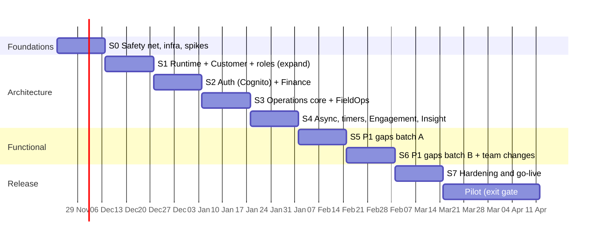

# 09 · Roadmap and migration plan

**Approach: strangler fig inside the monolith.** The prototype keeps running and shipping. Each module is moved to the standard (doc 03) one at a time behind unchanged routes, with the characterisation suite proving nothing changed. Functional work starts on a module as soon as that module is at Level 1.

Estimates assume the SAD team of 4.5 (lead, 2 full-stack, part-time QA, part-time UX) and 2-week sprints **[Confirm team and start date]**.

## 1. Plan at a glance

About 16 weeks to go-live, then the 4-week pilot exit gate (BRD §6). Dates are placeholders.

## 2. Sprints

### Sprint 0 — Safety net and foundations

| Work | Done when |
|---|---|
| Characterisation suite over all ~70 routes and the full BL lifecycle (doc 07 §2.1) | Green on `main`; snapshots committed |
| RLS isolation suite (doc 05 §8) | Green; runs on every PR |
| `.dependency-cruiser.cjs` with rules B-1…B-8; **current violations recorded as a baseline** | CI blocks new violations; baseline count published |
| CDK app with Identity, Data, Messaging, Api, Web, Observability stacks deployed to `dev` | Prototype runs in AWS `dev` with dev auth |
| GitHub Actions pipeline (doc 07 §3) up to staging | One-click deploy |
| Powertools logger/metrics/tracer in `shared/observability.ts` | Logs carry request and tenant ids |
| Spikes: **DB-1** (Data API vs pg latency), **AUTH-1** (Cognito feature plan, passwordless and region availability), **AUTH-2** (TOTP enrolment path) | Results recorded as ADR updates |
| Scope workshop: confirm doc 08 §2 statuses, fill §3 with the team's changes, answer the open decisions due in S0 (§6) | Backlog with `FC-` IDs |

### Sprint 1 — Runtime and the reference module

- UoW runner: `platform.begin_request()` (dev issuer), idempotency inside the transaction, scoped by principal, pool `max: 1` (S-3, S-4, X-6).
- Composition roots in `units/`; adapter selection moved out of module scope (A-5); bundles per runtime unit (A-6).
- **Customer** module to Level 1 as the **reference template** the team copies (SAD's Sprint 0 risk mitigation).
- Platform: `role`, `user_role`, `branch`, `identity` tables (expand); `authorize()` evaluator; policy matrix test with parity to `ROLE_PERMISSIONS`.

### Sprint 2 — Authentication and Finance

- Cognito pools, managed login, token handler endpoints, MFA enforcement, customer one-time code, login audit, dev routes compiled out (doc 04 §3; X-1, X-3).
- PWA: login redirect, CSRF header on refresh, `can()` from `/me` permissions.
- **Finance** to Level 1, including the `recordDisbursements` relay receiver.
- Platform to Level 1.

### Sprint 3 — Operations core and FieldOps

- **Clearance + Workflow** to Level 1 with `api/group.ts`; closure and phases from catalogue v2 markers (A-7); event envelope v1 (doc 06 §1).
- **FieldOps** to Level 1: command relays to Workflow (A-10), trip counter (A-11), link principals replace `skipPermission` (X-5).
- Named system principals replace `systemActor` (X-4).

### Sprint 4 — Async and read side

- Scheduler timers for SLA (+ warning), free time and DO validity; `workflow.timer` registry (S-1, S-2).
- Notification pipeline with `NotificationQueued`; WhatsApp webhook; outbox safety net (doc 06 §3).
- **Engagement** and **Insight** to Level 1; search projection and indexes (S-5, S-6); file scan worker (X-7).
- All four pollers removed from production; dependency-cruiser baseline reaches **zero**.

### Sprints 5–6 — MVP functional scope

Batch A (S5): branch scoping in UI and lists, CSV container import, document checklist gate (workflow v2), held-container exception task, DO validity alerts, POD PDF, WhatsApp templates and opt-in.
Batch B (S6): geotagged evidence, camera-to-PDF capture, mentions, Web Push, document version history, stage catalogue editor with guardrails, audit viewer, and the team's `FC-` items by priority.

### Sprint 7 — Hardening and go-live

- k6 with the 50,000-BL seed against staging; Lambda memory tuning; database minimum-capacity schedule.
- Restore drill, runbooks, alarm review, budget alarms.
- Security: ASVS L2 self-assessment; external penetration test booked (required before the first paying tenant beyond the pilot).
- Production deploy; migrate the pilot tenant's prototype data (users → Cognito invitations, identities linked).
- Pilot onboarding and training.

## 3. Exit criteria

| Milestone | Criteria |
|---|---|
| Architecture complete (end of S4) | Every module passes doc 03 §9; zero boundary violations; no pollers in AWS; characterisation suite unchanged since S0 except approved functional snapshots |
| Feature complete (end of S6) | Every BRD P1 Must is ✅ in doc 08 §2; Shoulds are ✅ or deferred by the product owner in writing |
| Go-live (end of S7) | Doc 07 §1 targets met on staging; restore drill passed; runbooks written; pilot users can sign in with MFA where required |
| MVP accepted (end of pilot) | BRD P1 exit gate: 4 consecutive weeks, < 5% of updates outside the system |

## 4. How each module refactor runs (repeatable recipe)

1. Create `api/index.ts` with DTOs for everything other modules use from this module today (find usages through its `public.ts` and through other modules' direct table reads).
2. Move the module's tables from `shared/schema.ts` into `adapters/persistence/schema.ts`.
3. For each route: extract a command or query handler; move rules into `domain/`; route becomes parse → handler → `sendResult`.
4. Replace this module's reads of other modules' tables with client ports.
5. Replace cross-group `tx` passing with a relay or an event (doc 03 §5).
6. Remove this module's entries from the dependency-cruiser baseline.
7. Characterisation suite unchanged → merge. Then functional work on the module can start.

## 5. Risks

| Risk | Impact | Mitigation |
|---|---|---|
| Refactor stalls functional delivery | Pilot slips | Module-by-module; functional work starts per module; S5–S6 reserved for functional scope |
| Characterisation suite too brittle (snapshot noise) | Ignored failures | Normalise ids and times; snapshot shapes and key values, not whole payloads where noisy |
| Data API latency too high (DB-1) | Slower writes | Option C (VPC + RDS Proxy) is pre-designed; cost difference known before S1 |
| Cognito feature or region gap (AUTH-1) | Customer sign-in delayed | Fallback: email + password for customers, or token-handler magic link |
| Team new to hexagonal/DDD | Slow S1–S3 | Customer reference module, pairing, this rulebook, lint enforcing it |
| The team's additional changes are larger than expected | Scope creep | Intake template (doc 08 §1); product owner prioritises against the pilot exit gate |
| Residency decision late | Region and database undecided | Infrastructure parameterised by region; Neon in `dev` until decided |

## 6. Open decisions

| # | Decision | Needed by | Owner |
|---|---|---|---|
| D-1 | Data residency → region and ADR-004 database | S0 | Client sponsor |
| D-2 | Cognito feature plan and passwordless availability in region (AUTH-1) | S0 | Tech lead |
| D-3 | Refresh token lifetimes (staff 7 days, customer 30 days?) | S1 | Product owner + security |
| D-4 | Branches and ports the client operates; default scoping of existing users | S1 | Client ops lead |
| D-5 | One identity per tenant in MVP, multi-tenant customer contacts in P2 | S1 | Product owner |
| D-6 | `PARTIAL` physical inspection result; what it means for release | S3 | Client ops lead |
| D-7 | Document checklist per commodity: which documents for which commodities | S4 | Client ops lead |
| D-8 | Multi-currency: is base-currency reporting with FX needed in P1? | S4 | Client finance |
| D-9 | Customs record-keeping period (retention) and privacy law | S5 | Client + counsel |
| D-10 | Outbox safety-net hours (doc 06 §3) and tenant business hours | S4 | Tech lead |
| D-11 | Error-tracking (Sentry) hosting region vs residency | S0 | Tech lead |
| D-12 | WhatsApp Business account: one platform number or one per agency | S4 | Product owner |
